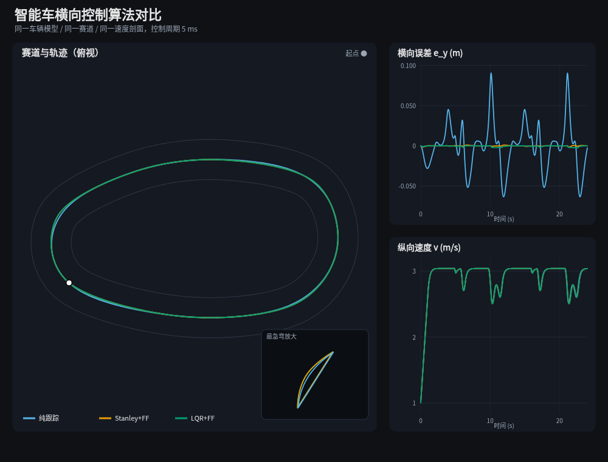

# 全国大学生智能车竞赛 · 电控运动学与控制算法学习工程

一套**可编译、可测试、可仿真**的 C 语言算法库，覆盖智能车电控里常见的运动学模型、巡线感知、滤波与姿态解算、PID 家族、路径跟踪和速度规划。

不是零散代码片段：每个模块都有头文件说明、公式推导文档和单元测试；主程序用同一辆车、同一条赛道跑三种横向控制器，直接对比效果。

> **第一次学？从这里开始：** [docs/00-从这里开始.md](docs/00-从这里开始.md)
> 12 章，按顺序读。每节都写清楚：作用、代码在哪、怎么用、大白话原理、动手步骤、常见错误、自测。

```
make test   # 655 项单元测试
make sim    # 单场景 + 三控制器对比仿真
make plot   # 生成 out/sim_compare.svg / .html
```

---



## 一分钟看结果

`make sim` 的实测输出（运动学自行车模型，控制周期 5 ms，赛道周长 32.6 m）：

| 控制器 | 横向误差 RMS | 最大误差 | 首圈用时 |
|---|---:|---:|---:|
| 纯跟踪 Pure Pursuit | 0.0300 m | 0.0906 m | 11.37 s |
| Stanley + 曲率前馈 | 0.0004 m | 0.0018 m | 11.40 s |
| LQR + 前馈 | 0.0009 m | 0.0029 m | 11.40 s |

纯跟踪在弯道会“切内线”，这是它只看前视点的几何特性；Stanley 和 LQR 加了曲率前馈后，在**模型完全匹配、无噪声**的仿真里几乎无静差。

> 注意：这是理想运动学仿真，没有噪声、延迟、轮胎滑移和模型失配。实车上差距会小很多，LQR 还需要随速度做增益调度。仿真的价值是看清算法结构，不是给实车排名。

可视化：`out/sim_compare.svg`（用浏览器/查看器打开），里面包含赛道轨迹、横向误差曲线、速度曲线和最急弯放大图。

---

## 目录结构

```
smartcar-algo/
├── include/sc/          # 对外头文件（每个模块一份，带公式和参数说明）
├── src/                 # 实现
├── tests/test_main.c    # 650 项断言测试
├── sim/                 # 闭环仿真（赛道生成 + 三控制器对比）
├── tools/plot_sim.py    # 纯标准库 SVG 画图（不需要 matplotlib）
├── docs/                # 中文学习文档
└── out/                 # 仿真输出（CSV / SVG / HTML）
```

| 目录 | 内容 |
|---|---|
| `include/sc/` + `src/` | 算法本体，可直接拷进 Keil / IAR / RT-Thread 工程 |
| `tests/` | 每个模块的数值正确性验证 |
| `sim/` | 车辆模型 + 赛道 + 控制器对比 |
| `docs/` | 公式、调参步骤、排错清单 |

---

## 算法地图

### 1. 车辆运动学（`kinematics.c`）

| 算法 | 函数 | 用途 |
|---|---|---|
| 差速驱动正逆解 | `sc_diff_forward` / `sc_diff_inverse` | 两轮差速、履带、双电机 |
| 编码器测速 | `sc_diff_wheel_speed` | 脉冲数 → m/s |
| 差速航迹推算 | `sc_diff_odometry` | 精确圆弧积分，原地旋转不丢位置 |
| 阿克曼转角 | `sc_ackermann_steer_from_curvature` | 曲率 ↔ 前轮转角 |
| 内外轮转角 | `sc_ackermann_wheel_angles` | 阿克曼梯形几何 |
| 自行车模型积分 | `sc_ackermann_integrate` | 仿真与预测 |
| 前轴参考模型 | `sc_ackermann_integrate_front` | 摄像头装在车头时 |
| 麦克纳姆轮 | `sc_mecanum_inverse` / `sc_mecanum_forward` | 四轮麦轮全向移动 |
| 三轮全向 | `sc_omni3_inverse` / `sc_omni3_forward` | 120° 全向轮 |
| 平衡车模型 | `sc_balance_state_space` | 倒立摆线性化，接 LQR |

### 2. 巡线感知

| 算法 | 函数 | 文件 |
|---|---|---|
| 大津法二值化 | `sc_otsu` / `sc_binarize` | `camera_line.c` |
| 八邻域爬线 | `sc_trace_8` | `camera_line.c` |
| 边线逐行扫描 | `sc_scan_edges` | `camera_line.c` |
| 中线平滑 | `sc_edge_smooth_center` | `camera_line.c` |
| 像素/物理曲率 | `sc_centerline_curvature_px` / `sc_ground_curvature` | `camera_line.c` |
| 逆透视 IPM | `sc_ipm_pixel_to_ground` / `sc_ipm_ground_to_pixel` | `camera_line.c` |
| 赛道元素识别 | `sc_classify_element` | `camera_line.c` |
| 电感归一化 | `sc_emag_update` | `emag.c` |
| 差比和 | `sc_emag_diff_ratio` | `emag.c` |
| 二次函数拟合 | `sc_emag_quadratic_offset` | `emag.c` |
| 五电感解算 | `sc_emag_offset_5` | `emag.c` |
| 加权质心 | `sc_emag_weighted_centroid` | `emag.c` |
| 竖直电感方向 | `sc_emag_direction` | `emag.c` |

### 3. 滤波与姿态（`filter.c` / `attitude.c`）

| 算法 | 函数 |
|---|---|
| 一阶低通 | `sc_lpf1_step` |
| 滑动平均 / 中值 | `sc_ma_step` / `sc_median_step` |
| 斜率限制 | `sc_rate_lim_step` |
| 一维卡尔曼 | `sc_kf1_step` |
| 位置+速度卡尔曼 | `sc_kf2_predict` / `sc_kf2_update` |
| 加速度倾角 | `sc_accel_pitch` / `sc_accel_roll` |
| 互补滤波 | `sc_comp_update` |
| Mahony 四元数 | `sc_mahony_update` |
| 四元数转欧拉角 | `sc_quat_to_euler` |
| 陀螺零漂校准 | `sc_gyro_cal_feed` |

### 4. PID 家族（`pid.c` / `fuzzy_pid.c` / `adrc.c`）

| 算法 | 函数 |
|---|---|
| 位置式 PID | `sc_pid_update`（`SC_PID_POSITION`） |
| 增量式 PID | `sc_pid_update`（`SC_PID_INCREMENTAL`） |
| 积分分离 | `sc_pid_set_integral_separation` |
| 抗积分饱和 | 内置条件积分 |
| 不完全微分 | `sc_pid_set_derivative_filter` |
| 微分先行 | `sc_pid_set_derivative_on_measurement` |
| 死区 | `sc_pid_set_deadband` |
| 前馈叠加 | `sc_pid_update_ff` |
| 模糊 PID | `sc_fuzzy_pid_update` |
| 自抗扰 ADRC | `sc_adrc_update` |

### 5. 路径跟踪（`pure_pursuit.c` / `stanley.c` / `lqr.c`）

| 算法 | 函数 | 关键参数 |
|---|---|---|
| 纯跟踪 | `sc_pp_steer` | 前视距离 `ld` |
| Stanley | `sc_stanley_steer_ff` | 横向增益 `k`、软化速度 |
| LQR | `sc_lqr_track_update` | Q/R 权重、速度调度 |
| 预瞄控制 | `sc_preview_steer` | 预瞄时间、k_y、k_psi |
| 折线投影/预览 | `sc_path_project` / `sc_path_lookahead` | 路径工具 |
| Catmull-Rom 平滑 | `sc_catmull_rom` | 路径预处理 |
| 小型线性代数 | `sc_lqr_discrete` | 离散 Riccati |

### 6. 速度规划与执行器

| 算法 | 函数 |
|---|---|
| 曲率限速 | `sc_speed_limit_from_curvature` |
| 全局速度剖面 | `sc_speed_profile_build` |
| 梯形规划 | `sc_trap_plan` / `sc_trap_speed_at_distance` |
| 在线 S 型规划 | `sc_scurve_step` |
| 舵机标定/限幅 | `sc_servo_update` |
| 电机死区/掉压补偿 | `sc_motor_update` |

---

## 学习进程

详细到每天的任务、动手实验和过关问题，见 **[docs/专题/00-学习进程.md](docs/专题/00-学习进程.md)**。
下面只是主干，完整版按 4 周、20 天排。

| 阶段 | 内容 | 对应文档 |
|---|---|---|
| 第 1 天 | 编译、跑测试和仿真，看懂坐标与符号约定 | 本页 + `docs/01` |
| 第 2–3 天 | 差速、阿克曼、麦轮、全向轮运动学；编码器测速 | `docs/01` |
| 第 4–5 天 | 摄像头巡线：二值化、爬线、边线、IPM、曲率 | `docs/02` |
| 第 6 天 | 电磁巡线：归一化、差比和、二次拟合 | `docs/03` |
| 第 7 天 | 滤波与姿态：低通、卡尔曼、互补、Mahony | `docs/04` |
| 第 8–9 天 | PID：位置式/增量式/串级/抗饱和/模糊/ADRC | `docs/05` |
| 第 10–11 天 | 路径跟踪：纯跟踪、Stanley、LQR、前馈 | `docs/06` |
| 第 12 天 | 速度规划与舵机/电机执行器 | `docs/07` |
| 第 13 天 | 改仿真参数，观察稳定性与误差变化 | `docs/08` |
| 第 14 天 | 往 MCU 移植：中断、定点、内存、安全 | `docs/09` |

---

## 代码约定（很重要）

全工程统一，移植时别混用：

- 单位：米、秒、弧度、m/s、rad/s。
- 车体坐标：**x 向前，y 向左，theta 逆时针为正**。
- 角速度 `w > 0` 为左转；前轮转角 `delta > 0` 为左转。
- 路径横向误差 `e_y > 0` 表示**车在路径左侧**；航向误差 `e_psi = theta - 路径切向`。
- PID 的 `ki`、`kd` 都按秒计，内部乘 `dt`，换采样率不用改参数。
- 所有模块不做动态内存分配，状态都在结构体里，方便放 MCU。

---

## 常用命令

```sh
make test      # 跑 655 项单元测试
make sim       # 跑仿真，输出 CSV
make plot      # 由 CSV 生成 SVG/HTML
make all       # test + sim + plot
make clean
```

单独编译某个模块检查语法：

```sh
cc -std=c11 -Iinclude -fsyntax-only src/pid.c
```

---

## 仿真输出说明

| 文件 | 内容 |
|---|---|
| `out/track.csv` | 赛道点、弧长、曲率、目标速度 |
| `out/pp.csv` / `stanley.csv` / `lqr.csv` | 每 5 ms 一行：位姿、速度、转角、误差 |
| `out/sim_single.csv` | 纯跟踪的完整遥测 |
| `out/metrics.txt` | 三种控制器的指标表 |
| `out/sim_compare.svg` | 可视化（查看器可直接打开） |
| `out/sim_compare.html` | 带页面样式的版本 |

---

## 这套代码适合谁

- 刚进智能车队伍，想系统补齐电控算法的人。
- 已经会调 PID，但说不清纯跟踪/Stanley/LQR 区别的人。
- 想把算法从“能跑”推进到“知道为什么这样跑”的人。

## 这套代码不是什么

- 不是某一届比赛的获奖代码。赛道元素识别只是骨架，阈值必须按你的赛道重标。
- 不是可直接烧录的工程：没有 MCU 外设驱动（PWM、ADC、摄像头 DCMI、编码器定时器），需要你自己接 `hal` 层。
- 不包含视觉神经网络、SLAM、多车协同等进阶内容。

---

## 文档索引

### 先学

- [从零开始学习手册](docs/00-从这里开始.md) ← **新手先读这个**
  正文在 [`docs/手册/`](docs/手册/)
- [学习进程（4 周）](docs/专题/00-学习进程.md)

### 深入阅读（专题）

1. [车辆运动学模型](docs/专题/01-运动学模型.md)
2. [摄像头巡线](docs/专题/02-摄像头巡线.md)
3. [电磁巡线](docs/专题/03-电磁巡线.md)
4. [滤波与姿态解算](docs/专题/04-滤波与姿态.md)
5. [PID 家族与高级控制](docs/专题/05-PID家族.md)
6. [路径跟踪控制](docs/专题/06-路径跟踪.md)
7. [速度规划与执行器](docs/专题/07-速度规划与执行器.md)
8. [仿真、调参与排错](docs/专题/08-仿真与调参.md)
9. [移植到 MCU](docs/专题/09-移植到MCU.md)
