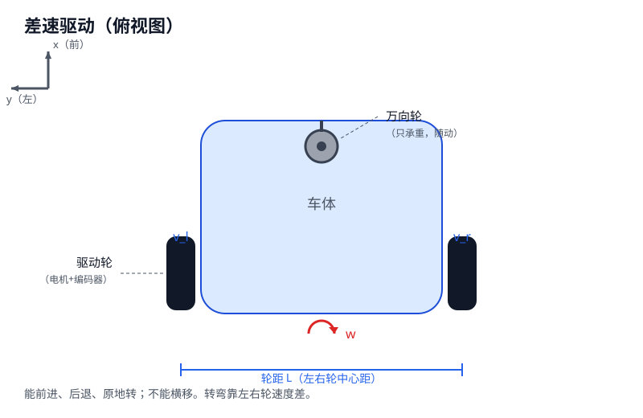
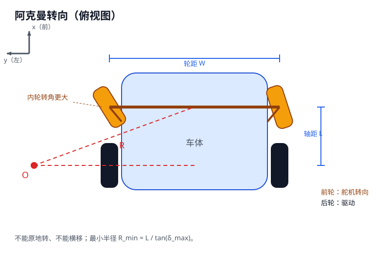
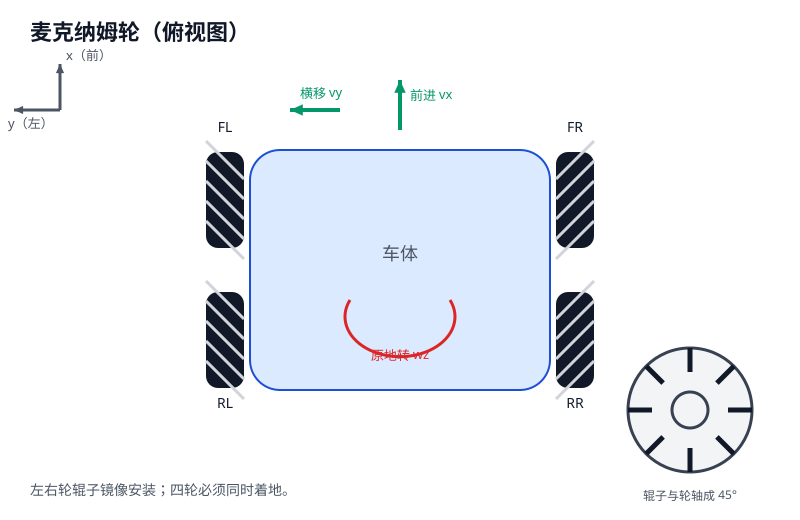
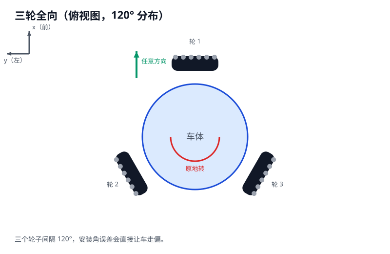
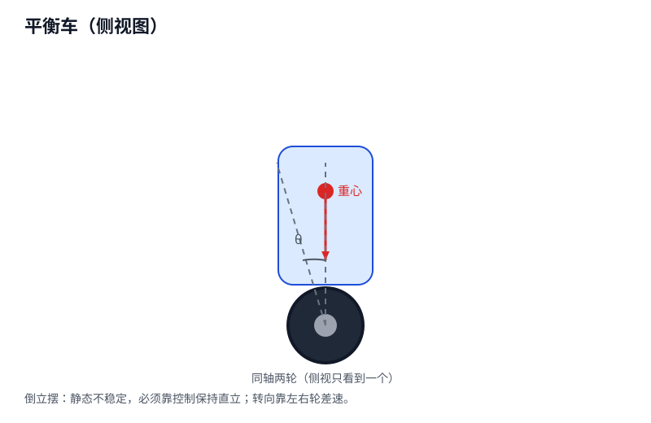

# 第 1 章 · 先认识车：轮子与机械结构

> 学运动学之前，先知道你的车长什么样。
> 同样是四个轮子，普通轮、麦轮、全向轮，公式完全不一样。装错模型，后面的控制全错。

---

## 1.1 为什么先看机械结构

运动学公式不是凭空来的，它来自一个约束：

> **轮子只能沿着它滚动的方向走，不能横向滑。**

不同的机械结构，这个约束的写法不同：

- 两个普通轮 → 只能靠速度差转弯。
- 前轮能转向 → 靠前轮角度转弯。
- 麦轮/全向轮 → 辊子把力分解到横向，能横移。

所以顺序必须是：**先认轮子 → 再选模型 → 再套公式**。

---

## 1.2 五种常见结构

### 1.2.1 两轮差速 + 万向轮





| 项目 | 说明 |
|---|---|
| 轮子 | 两个带电机/编码器的驱动轮 + 1~2 个万向轮 |
| 转向 | 靠左右轮速度差 |
| 能做什么 | 前进、后退、原地转 |
| 不能做什么 | 横移 |
| 公式 | `v=(v_l+v_r)/2`，`w=(v_r-v_l)/L` |
| 代码 | 第 3 章，`sc_diff_*` |
| 关键参数 | 轮距 `L`、轮径 `r` |

**机械坑**：

- 两个驱动轮必须**同轴**（轴线重合），否则转弯时轮胎会拖。
- 万向轮要能自由转，但承重不能太大，否则转向阻力大。
- 轮胎打滑时，编码器算出来的速度会偏大。

### 1.2.2 阿克曼（前轮转向 + 后轮驱动）





| 项目 | 说明 |
|---|---|
| 轮子 | 前轮通过舵机/连杆转向，后轮驱动 |
| 转向 | 前轮转角 |
| 能做什么 | 前进、转弯 |
| 不能做什么 | 横移、原地转 |
| 公式 | `R = L / tan(delta)`，内外轮不同角 |
| 代码 | 第 4 章，`sc_ackermann_*` |
| 关键参数 | 轴距 `L`、前轮轮距 `W`、最大转角 |

**机械坑**：

- 内外轮转角要满足阿克曼关系，否则轮胎侧滑。
- 舵机中值不准，车会一直跑偏。
- 转向连杆有虚位，控制器命令和实际转角对不上。
- 后轮如果没有差速器，转弯时内外轮会互相拖。

### 1.2.3 麦克纳姆轮（四轮，45° 辊子）





| 项目 | 说明 |
|---|---|
| 轮子 | 四个麦轮，每个轮子外圈有一圈 45° 辊子 |
| 转向 | 四个轮子独立驱动，靠组合产生横向力 |
| 能做什么 | 前进、横移、原地转、斜行 |
| 公式 | 四轮逆解，见第 3 章 |
| 代码 | 第 3 章，`sc_mecanum_*` |
| 关键参数 | 轮径 `r`、半轴距 `lx`、半轮距 `ly` |

**机械坑**：

- 左右轮的辊子**镜像安装**。装反了，横移方向会反，甚至原地打转。
- 四个轮子必须**同时着地**。有一个悬空，车就会往一边跑。
- 对地面平整度、灰尘、缝隙很敏感。
- 横移时辊子打滑，里程计不准。

### 1.2.4 三轮全向（120°）





| 项目 | 说明 |
|---|---|
| 轮子 | 三个全向轮，轮缘有小滚子，可横向滑动 |
| 转向 | 三个轮子独立驱动 |
| 能做什么 | 全向移动、原地转 |
| 公式 | 见第 3 章 |
| 代码 | 第 3 章，`sc_omni3_*` |
| 关键参数 | 轮径 `r`、三个安装角 |

**机械坑**：

- 安装角必须精确 120°，差 1° 走 1 m 就偏几厘米。
- 三个轮子要同时着地。
- 全向轮的小滚子容易卡灰尘。

### 1.2.5 平衡车 / 独轮车





| 项目 | 说明 |
|---|---|
| 轮子 | 两个同轴轮，车身重心在上 |
| 稳定 | 静态不稳定，必须主动控制 |
| 能做什么 | 前进、后退、原地转、保持直立 |
| 公式 | 倒立摆模型 |
| 代码 | 第 3 章，`sc_balance_*` |
| 关键参数 | 轮组质量 `M`、车身质量 `m`、质心高度 `l` |

**机械坑**：

- 重心越高，越难平衡，LQR 增益越大。
- 轮子摩擦力不够，会打滑，姿态估计会错。
- 电机响应慢，平衡环会振荡。

---

## 1.3 一张表选模型

| 你的车长什么样 | 转向方式 | 能横移吗 | 用哪个模型 | 看哪章 |
|---|---|---|---|---|
| 两个驱动轮 + 万向轮 | 轮速差 | 否 | 差速 | 第 3 章 |
| 前轮转向 + 后轮驱动 | 舵机 | 否 | 阿克曼 | 第 4 章 |
| 四个麦轮 | 四轮组合 | 是 | 麦克纳姆 | 第 3 章 |
| 三个全向轮 | 三轮组合 | 是 | 三轮全向 | 第 3 章 |
| 两个同轴轮 + 高重心 | 平衡控制 | 否 | 倒立摆 | 第 3 章 |

---

## 1.4 机械参数怎么量

| 参数 | 怎么量 | 用在哪 |
|---|---|---|
| 轮径 `r` | 卡尺量直径 ÷ 2；或推车 10 圈，距离 ÷ (2π×10) | 编码器测速 |
| 轮距 `L` | 左右轮**中心**距离 | 差速 |
| 轴距 `L` | 前轴中心到后轴中心 | 阿克曼 |
| 前轮轮距 `W` | 左右前轮中心距离 | 阿克曼内外轮 |
| `lx`、`ly` | 麦轮轴心到车体中心的纵向/横向距离 | 麦轮 |
| 质心高度 | 悬挂法，或分别称前后轮重量估算 | 平衡车 |
| 舵机中值 | 给中值 PWM，调机械连杆让车轮朝正前 | 舵机 |
| 最大转角 | 左右打满，用量角器量 | 限幅 |

**最容易错的两个**：

1. 把**车宽**当轮距。轮距是左右轮中心距。
2. 把**轴距**和**轮距**填反。轴距是前后，轮距是左右。

---

## 1.5 公式背后的假设

所有运动学模型都假设：

1. **纯滚动，无侧滑**：轮子只沿滚动方向走。
2. **车体刚性**：不变形。
3. **地面平整**：没有坡、没有坑。
4. **轮径不变**：负载下轮胎不塌。

这些假设在实车上只是近似：

- 轮胎软、地面滑 → 侧滑，公式算的位姿会漂。
- 有坡 → 重力分量没算进去。
- 麦轮横移 → 辊子打滑，里程计不准。

所以：**运动学是控制器的基础，不是实车定位的唯一来源。** 高速/高精度场合要加 IMU、视觉或激光。

---

## 1.6 拿到一辆实车，怎么判断用哪个模型

按顺序看：

1. **前轮能不能转向？** 能 → 阿克曼。
2. **轮子表面有没有斜着的辊子？** 有 45° 辊子 → 麦轮。
3. **轮缘有没有一圈小滚子？** 有 → 全向轮。
4. **有没有万向轮？** 有，且只有两个驱动轮 → 差速。
5. **断电后能不能站住？** 站不住 → 平衡车。

---

## 1.7 动手步骤

### 步骤 1：画俯视图

拿一张纸，画出你的车：

- 四个轮子的位置。
- 哪几个是驱动轮。
- 哪几个能转向。
- 有没有万向轮。
- 标出前后左右。

### 步骤 2：标参数

在图上标出：

- 轮距 `L`（左右轮中心）。
- 轴距（前后轴）。
- 轮径 `r`。
- 如果是麦轮，标 `lx`、`ly`。

### 步骤 3：选模型

对照 1.3 的表，写下你的车用哪个模型、看哪一章。

### 步骤 4：跑对应测试

```sh
cd /data/user/0/cc.codroid/files/home/workspace/smartcar-algo
make test
```

在输出里找到你需要的测试组：

- `-- kinematics`：差速、阿克曼、麦轮、全向、平衡
- `-- PID`：控制
- `-- camera` / `-- emag`：感知

---

## 1.8 常见错误

| 错误 | 后果 | 怎么改 |
|---|---|---|
| 四个固定轮当差速 | 转弯时后轮拖地 | 用阿克曼模型，或加万向轮 |
| 麦轮左右装反 | 横移方向反 | 检查辊子镜像 |
| 全向轮角度不准 | 走直线会偏 | 重新定位安装角 |
| 差速用阿克曼公式 | 转弯半径全错 | 先认结构再选模型 |
| 轮距量成车宽 | 角速度偏小 | 量左右轮中心距 |
| 忽略轮胎打滑 | 里程计漂 | 加 IMU/视觉融合 |

---

## 1.9 自测

1. 你的车后面两个轮子驱动，前面两个轮子能转向，用哪个模型？
2. 麦轮车能横移吗？为什么？
3. 麦轮左右轮为什么要镜像安装？
4. 平衡车为什么断电就倒？
5. 差速车的关键参数是轴距还是轮距？
6. 所有运动学模型共同依赖什么假设？

答案：

1. 阿克曼。
2. 能。45° 辊子把轮子的转动力分解出横向分量。
3. 左右轮辊子旋向相反，横向力才能同向叠加；装反会互相抵消。
4. 倒立摆是**不稳定平衡**，一偏重力矩就让它继续倒。
5. 轮距（左右轮中心距）。
6. 纯滚动、无侧滑、车体刚性、地面平整。

全对，进入第 3 章。
